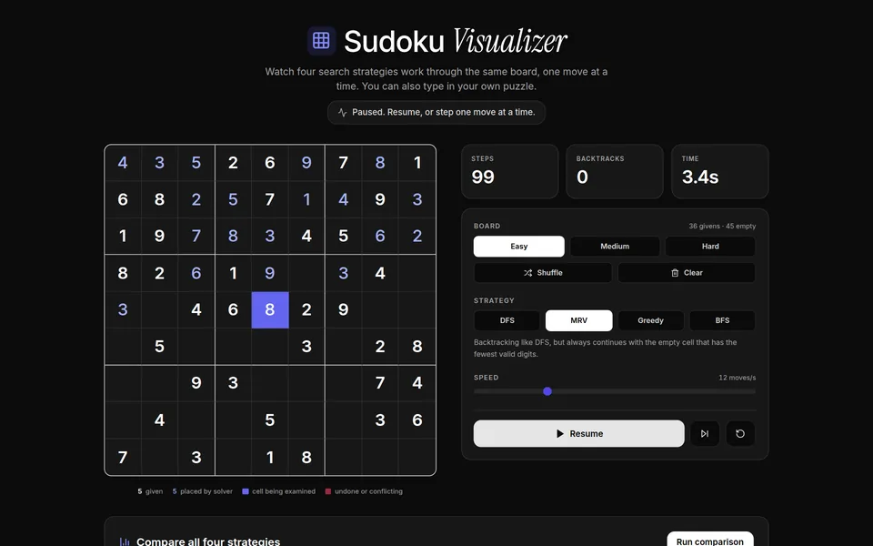
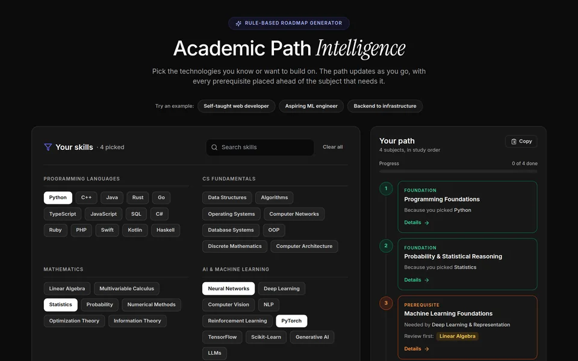
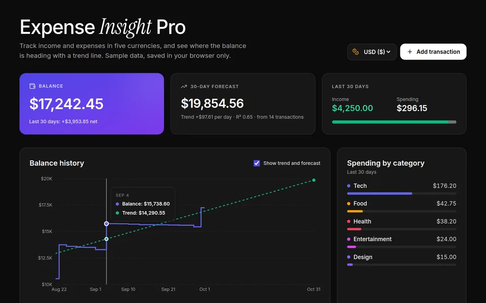

<div align="center">

# Aditya Tiwari — Portfolio

**B.Tech Computer Science student at IILM University (class of 2029, CGPA 8.79), looking for a software engineering internship.**

Every project runs live inside the page, links to its source, and has a case study on the design decisions, trade-offs and limits.

[**Live site**](https://adityatiwari98.vercel.app) · [GitHub](https://github.com/adityatiwari9t8) · [LinkedIn](https://www.linkedin.com/in/adityatiwari9t8) · [Resume](https://adityatiwari98.vercel.app/resume.pdf)


</div>

---

## The projects

Each project has a working demo embedded in the site and a case-study page (problem, what I built, what I learned, limits, stack) at `#/work/<id>`.

| | Project | What it does | Code |
| --- | --- | --- | --- |
|  | **Sudoku Algorithm Visualizer** | Four search strategies (DFS backtracking, BFS, greedy and MRV) solve the same board step by step, then get compared on steps, backtracks and time. | [Repo](https://github.com/adityatiwari9t8/sudoku-algorithm-visualizer) |
|  | **Academic Path Intelligence** | Turns the skills you already have into an ordered learning roadmap, using a depth-first topological sort so every prerequisite comes first. | [Repo](https://github.com/adityatiwari9t8/academic-path-intelligence) |
|  | **Expense Insight Pro** | A five-currency finance dashboard that forecasts the balance 30 days ahead with a least-squares trend line written from scratch. | [Repo](https://github.com/adityatiwari9t8/expense-insight-pro) |

## What's in the site

- **A concise introduction.** Clear project and resume actions, visible contact, and a quiet dotted-wave illustration. The wave holds still on phones and for reduced motion, pauses off screen, and is capped at 30 fps on larger screens.
- **A flexible project grid.** The three current applications are working examples while more substantial work is in progress. Each has a demo, source link, and case study. Only the current theme’s screenshot is loaded; walkthrough videos are played on request within case studies. A future main project can use `featured: true` for a full-width lead card.
- **Readable case studies.** Section navigation, architecture flows, stack, implementation details, learning, and honest limitations, with shareable links at `#/work/<id>`.
- **Compact background.** Education and experience in a timeline, grouped skills, current interests, and expandable certificates.
- **Direct contact.** Email, copy-email, and LinkedIn actions. No form or implied delivery; email links explicitly open the visitor's email app. Failed clipboard writes show manual-copy guidance.
- **An optional AI assistant.** Available from the desktop navigation, mobile menu, or command menu. Answers stream through `api/chat.ts`; its profile comes from the same data files as the site. Starter questions use instant local quick answers. Custom questions are limited to four per rolling minute, with a friendly pause message before the fifth (no visible quota or countdown). The allowance persists across resets, panel closes and reloads; quick answers stay available. A matching API guard and provider-cooldown fallback protect the endpoint. The API guard is best-effort per IP within each serverless instance; Google’s project quota is shared across visitors.
- **Keyboard command menu.** Cmd+K / Ctrl+K for navigation, projects, resume, contact, and theme.
- **Light by default, with a dark toggle.** Every page load starts light; a toggle affects only the current document. Shared buttons, surfaces, typography, visible focus states, and short transitions keep both themes consistent. Content stays visible before scroll animations run.
- **Self-hosted fonts and optional analytics.** Latin font subsets are bundled; cookie-less analytics are off by default.

## Run it locally

```bash
git clone https://github.com/adityatiwari9t8/portfolio-website.git
cd portfolio-website
npm install
npm run dev        # http://localhost:5173
```

```bash
npm test           # quota, API fallback and default-theme regression checks (no Gemini calls)
npm run build      # type-check, then production build into dist/
npm run preview    # serve the production build locally
```

Needs Node 18 or newer. For the AI assistant to answer locally, put a free [Google AI Studio](https://aistudio.google.com/apikey) key in `.env.local` as `GEMINI_API_KEY=...` (the file is git-ignored); `npm run dev` serves `/api/chat` itself.

## How it's organised

```text
src/
├── App.tsx              page layout and section order
├── data/
│   ├── site.ts          name, email, social links, status line, nav order
│   ├── content.ts       hero, about, photos, education, experience, skills, contact text
│   └── projects.ts      the projects and their case studies
├── components/          page sections and effects (DotWave, Tilt, Reveal, ...)
│   └── demos/           the embedded project demos
└── lib/                 router, theme store, scroll and active-section helpers, cursor light, dialog helper, view transitions
api/                     Vercel functions: chat.ts (the AI assistant) and _profile.ts (its instructions, built from src/data)
public/                  photos, project screenshots and demo videos, resume, social preview image
resume/                  source of the resume PDF
```

All copy and links live in `src/data/`, so updating the site rarely means touching a component.

| To change… | Edit |
| --- | --- |
| Name, email, social links, status line | `src/data/site.ts` |
| Hero, project introduction, about, education, experience, certificates, skills | `src/data/content.ts` |
| Projects and case studies | `src/data/projects.ts` |
| Resume | `resume/resume.html`, then save it as `public/resume.pdf` (see below) |

### Adding experience, certificates or skills

Every list in `src/data/content.ts` can grow without touching a component:

- **Experience:** add an object to `EXPERIENCE`, newest first. The first three show; the rest sit behind a "Show all" button.
- **Certificates:** add an object to `CERTIFICATIONS`. Give it a `url` (opens in a new tab) or an `image` in `public/certificates/` (opens in a viewer on the page). The first six show; the rest fold away.
- **Skills:** add to any group in `TOOLKIT`, or add a whole new group (`{ label: 'Cloud', items: [...] }`). CS fundamentals live in `EDUCATION.coursework` and show in the education card.
- **Hero text:** `HERO` (role, focus line, the one-line motto and the short intro). The name and status line come from `SITE`, and the section order in the nav comes from `NAV`, both in `src/data/site.ts`.
- **About portrait:** the first entry of `STORY_PHOTOS` supplies the portrait and alternative text. Both themes use the original photo with a consistent CSS treatment.

### Adding a project

1. Add a light and a dark screenshot to `public/` (WebP, about 960 px wide), and optionally a short MP4 per theme in `public/demo/`.
2. Copy an object in `PROJECTS` in `src/data/projects.ts` and change its fields.
3. Fill in `study` (problem, what was built, what was learned, limits, stack). It becomes the case-study page.
4. Add `repo` and `live` links if they exist. The buttons appear automatically.

### Updating the resume

Edit `resume/resume.html`, then print it to PDF with Chrome (A4, no headers and footers) and save it as `public/resume.pdf`. From the command line:

```bash
google-chrome --headless --no-pdf-header-footer --print-to-pdf=public/resume.pdf resume/resume.html
```

On macOS, use `"/Applications/Google Chrome.app/Contents/MacOS/Google Chrome"` in place of `google-chrome`.

## Deploying

The site is a plain Vite app, so Vercel needs no extra settings: import the repo, keep the framework preset on **Vite**, and every push to `main` redeploys.

- **Site address.** On Vercel the address is picked up at build time (canonical link, sitemap, absolute preview-image URLs). Anywhere else, set `SITE_URL=https://your-domain.com` before `npm run build`.
- **AI assistant.** Add `GEMINI_API_KEY` (a free Google AI Studio key) to the Vercel project's environment variables and redeploy. Keep billing off on that Google project and it can never cost anything; past the free quota the chat shows a friendly "email me" message. It tries three free models in turn (each has its own free quota); set `GEMINI_MODELS` (comma-separated) to change the list without a code change.
- **Analytics (optional).** Enable **Analytics** in the Vercel project, add the environment variable `VITE_ANALYTICS=1` and redeploy.

## Contact

**adityatiwari.connect@gmail.com** · [LinkedIn](https://www.linkedin.com/in/adityatiwari9t8)

Open to software engineering internships and second-year or early-career intern programs, on backend or full-stack teams. Remote, hybrid or on-site, anywhere.

Chat replies use a short loading state and buffered text reveal, with a Stop control and persistent suggested questions. Prepared answers remain local and labeled as profile content; reduced-motion preferences skip the text animation.

The work section keeps current projects alongside the first in-progress entry from `BUILDING`. Its goals are presented as planned work; the callout disappears when a published project uses the same ID. Featured projects sort ahead of other entries automatically.

Demo failures are contained within the overlay, with reload, source-code and return controls. The command menu and contact actions share confirmed clipboard feedback, including a fallback inside active dialogs. `npm test` covers clipboard failure and cleanup alongside chat policy.
