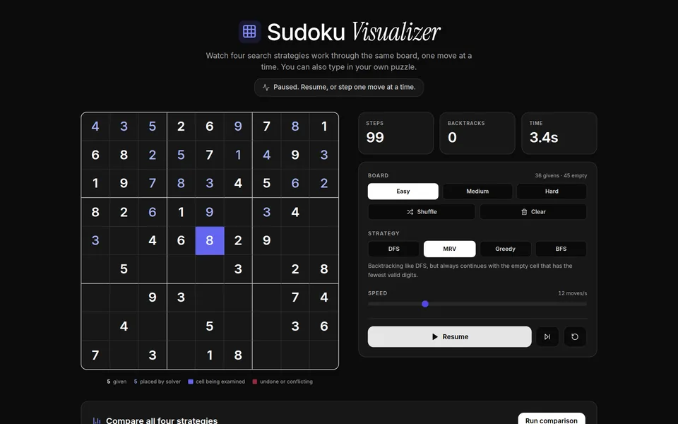
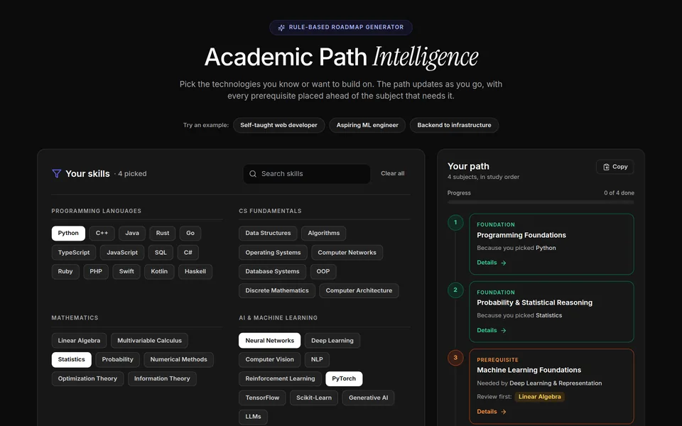
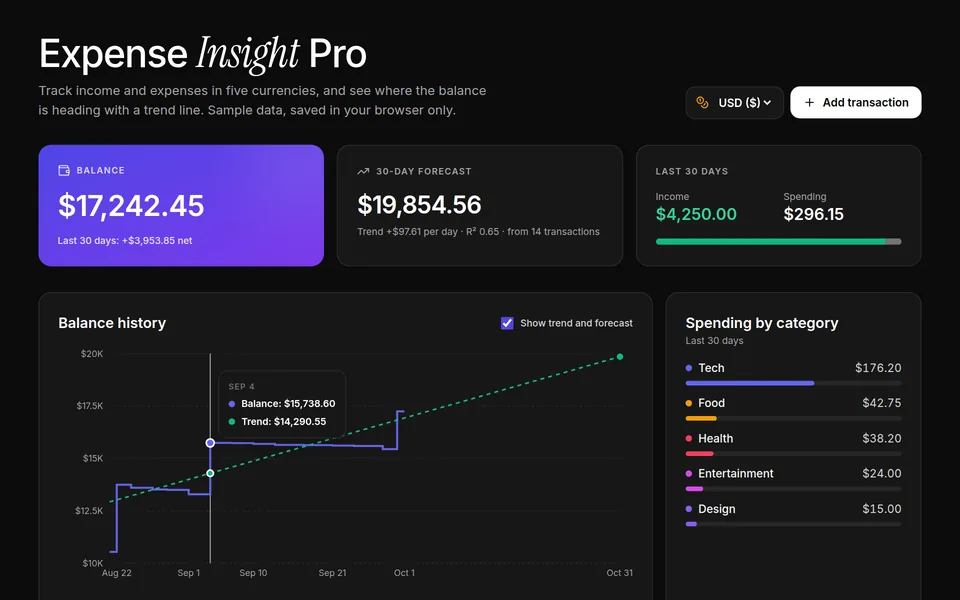

<div align="center">

# Aditya Tiwari — Portfolio

**B.Tech Computer Science student at IILM University (class of 2029, CGPA 8.79), looking for a software engineering internship.**

Project entries can include live demos, source links, and case studies on the design decisions, trade-offs and limits. The collection can grow as new work is completed.

[**Live site**](https://adityatiwari98.vercel.app) · [GitHub](https://github.com/adityatiwari9t8) · [LinkedIn](https://www.linkedin.com/in/adityatiwari9t8) · [Resume](https://adityatiwari98.vercel.app/resume.pdf)


</div>

---

## The projects

Each project has a working demo embedded in the site and a case-study page (problem, what I built, what I learned, limits, stack) at `#/work/<id>`.

| | Project | What it does | Code |
| --- | --- | --- | --- |
|  | **Sudoku Algorithm Visualizer** | Four search strategies (DFS backtracking, BFS, greedy and MRV) solve the same board step by step, then get compared on steps, backtracks and time. | [Repo](https://github.com/adityatiwari9t8/sudoku-algorithm-visualizer) |
|  | **Academic Path Intelligence** | Turns the skills you already have into an ordered learning roadmap, using a depth-first topological sort so every prerequisite comes first. | [Repo](https://github.com/adityatiwari9t8/academic-path-intelligence) |
|  | **Expense Insight Pro** | A five-currency finance dashboard that forecasts the balance 30 days ahead with a least-squares trend line written from scratch. | [Repo](https://github.com/adityatiwari9t8/expense-insight-pro) |

## What's in the site

- **Minimal, light by default.** White and graphite surfaces, system typography, centered desktop navigation, and responsive project previews. Light is the default. The header toggle remembers an explicit light/dark choice, applies it before the page paints, and themes the embedded demos and chatbot too.
- **Depth on interaction.** Project previews tilt slightly toward the pointer. Opening a panel brings it forward, and buttons respond to a press. Reduced-motion preferences disable the animated transitions; there is no background renderer.
- **Replaceable project content.** A filterable gallery with theme-matched screenshots, project dialogs, source links, and working demos. Edit `src/data/projects.ts`; shareable links remain `#/work/<id>`.
- **About and toolkit.** Personal introduction, portrait, education, résumé, and expandable skill groups.
- **Optional playground.** Collapsed by default to keep the page quiet. Expand it to explore simulated request caching or a live bubble sort.
- **Direct contact.** Email, verified copy-email feedback, GitHub, and LinkedIn.
- **Accessibility.** Keyboard navigation, visible focus, dialog focus management, mobile navigation, and native scrolling.
- **Optional analytics.** Existing cookie-less analytics remain off by default. The profile chatbot is available from Ask AI in the navigation and the floating chat button, with local quick answers and streaming replies through the existing API.

See [DESIGN.md](DESIGN.md) for the visual direction.

## Run it locally

```bash
git clone https://github.com/adityatiwari9t8/portfolio-website.git
cd portfolio-website
npm install
npm run dev        # http://localhost:5173
```

```bash
npm test           # quota, API fallback, clipboard and light-theme regression checks (no Gemini calls)
npm run build      # type-check, then production build into dist/
npm run preview    # serve the production build locally
```

Needs Node 18 or newer. For the AI assistant to answer locally, put a free [Google AI Studio](https://aistudio.google.com/apikey) key in `.env.local` as `GEMINI_API_KEY=...` (the file is git-ignored); `npm run dev` serves `/api/chat` itself.

## How it's organised

```text
src/
├── App.tsx              page layout and section order
├── data/
│   ├── site.ts          name, email, social links, status line, nav order
│   ├── content.ts       hero, about, photos, education, experience, skills, contact text
│   └── projects.ts      the projects and their case studies
├── studio.css           the minimal light visual system
├── components/
│   ├── studio/          interactive project previews and playground
│   └── demos/           the embedded project demos
└── lib/                 router, theme store, scroll and active-section helpers, cursor light, dialog helper, view transitions
api/                     Vercel functions: chat.ts (the AI assistant) and _profile.ts (its instructions, built from src/data)
public/                  photos, project screenshots and demo videos, resume, social preview image
resume/                  source of the resume PDF
```

Projects, profile details, education, and skills live in `src/data/`. The new editorial headings and navigation live in `src/App.tsx`.

| To change… | Edit |
| --- | --- |
| Name, email, social links, status line | `src/data/site.ts` |
| Editorial headings and navigation | `src/App.tsx` |
| About introduction, portrait, education, skills | `src/data/content.ts` |
| Projects and case studies | `src/data/projects.ts` |
| Resume | `resume/resume.html`, then save it as `public/resume.pdf` (see below) |

### Editing profile details

- **Skills:** extend a `TOOLKIT` group or add another group. It becomes an expandable row.
- **Education:** edit `EDUCATION` and the education label in `src/App.tsx`.
- **About portrait:** the first entry of `STORY_PHOTOS` supplies the portrait and alternative text.
- **Experience and certificates:** the prior data and components are retained for future use, but are not displayed in this design.

### Adding a project

1. Add a light and a dark screenshot to `public/` (WebP, about 960 px wide), and optionally a short MP4 per theme in `public/demo/`.
2. Copy an object in `PROJECTS` in `src/data/projects.ts` and change its fields.
3. Fill in `study` (problem, what was built, what was learned, limits, stack). It becomes the case-study page.
4. Add `repo` and `live` links if they exist. The buttons appear automatically.

### Updating the resume

Edit `resume/resume.html`, then print it to PDF with Chrome (A4, no headers and footers) and save it as `public/resume.pdf`. From the command line:

```bash
google-chrome --headless --no-pdf-header-footer --print-to-pdf=public/resume.pdf resume/resume.html
```

On macOS, use `"/Applications/Google Chrome.app/Contents/MacOS/Google Chrome"` in place of `google-chrome`.

## Deploying

The site is a plain Vite app, so Vercel needs no extra settings: import the repo, keep the framework preset on **Vite**, and every push to `main` redeploys.

- **Site address.** On Vercel the address is picked up at build time (canonical link, sitemap, absolute preview-image URLs). Anywhere else, set `SITE_URL=https://your-domain.com` before `npm run build`.
- **AI assistant.** Add `GEMINI_API_KEY` (a free Google AI Studio key) to the Vercel project's environment variables and redeploy. Keep billing off on that Google project and it can never cost anything; past the free quota the chat shows a friendly "email me" message. It tries three free models in turn (each has its own free quota); set `GEMINI_MODELS` (comma-separated) to change the list without a code change.
- **Analytics (optional).** Enable **Analytics** in the Vercel project, add the environment variable `VITE_ANALYTICS=1` and redeploy.

## Contact

**adityatiwari.connect@gmail.com** · [LinkedIn](https://www.linkedin.com/in/adityatiwari9t8)

Open to software engineering internships and second-year or early-career intern programs, on backend or full-stack teams. Remote, hybrid or on-site, anywhere.

Chat replies use a short loading state and buffered text reveal, with a Stop control and persistent suggested questions. Prepared answers remain local and labeled as profile content; reduced-motion preferences skip the text animation.

The work section follows the order of `PROJECTS`. Mark an entry as featured to give its preview a full row.

Demo failures are contained within the overlay, with reload, source-code and return controls. The command menu and contact actions share confirmed clipboard feedback, including a fallback inside active dialogs. `npm test` covers clipboard failure and cleanup alongside chat policy.
